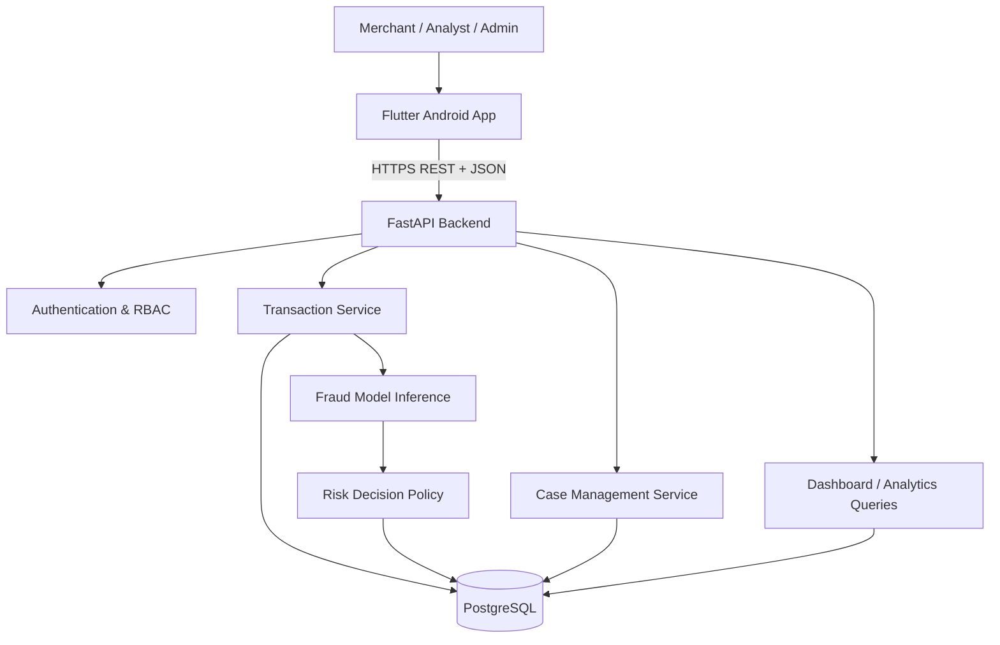
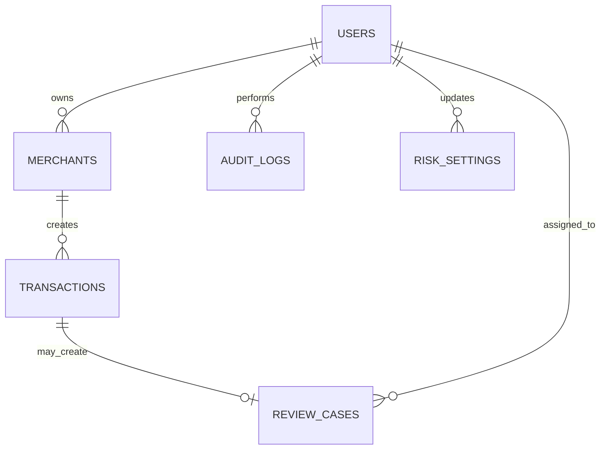

# PayShield — Master Project Documentation

> **Project type:** University-level Android-first Flutter application  
> **Domain:** FinTech · Cybersecurity · Artificial Intelligence  
> **Purpose:** Demonstrate transaction-risk analysis, fraud prediction, merchant monitoring, and human review.  
> **Documentation language:** Bangla explanations with English technical terms, identifiers, and code terminology.

---

## 0. How to use this document

এই document-টাই PayShield-এর **single source of truth**। তুমি, তোমার team এবং Antigravity—সবাই implementation-এর সময় এই document follow করবে। কোনো requirement বা architecture change করতে হলে আগে এখানে change করবে, তারপর code update করবে।

তোমার শেখার পদ্ধতি:

1. প্রথমে section-এর concept পড়বে।
2. Antigravity-কে একটি ছোট milestone implement করতে দেবে—একবারে পুরো application নয়।
3. Antigravity-কে changed files, decisions, commands, test results এবং explanation দিতে বলবে।
4. নিজে app run করে দেখবে এবং code-এর important অংশ বুঝবে।
5. milestone-এর acceptance criteria pass না করলে পরের milestone শুরু করবে না।

### Project roles

| Role | Responsibility |
|---|---|
| **You — Product Owner & Student Developer** | Requirement বোঝা, decision approve করা, code run/test করা, এবং viva/defense দেওয়া। |
| **ChatGPT — Dungeon Master / Technical Mentor** | Architecture guide, concept teacher, reviewer, debugging partner, documentation keeper, এবং defense preparation। |
| **Antigravity — Implementation Agent** | Approved milestone অনুযায়ী code লেখা, test চালানো, errors fix করা, এবং implementation explain করা। |

**Important:** AI-generated code automatically correct ধরে নেওয়া যাবে না। তুমি code বুঝবে, run করবে, test করবে এবং নিজে explain করতে পারবে—এটাই project-এর success criterion।

---

# 1. Project overview

## 1.1 What is PayShield?

PayShield is a mobile-based payment fraud-risk monitoring system. It receives a transaction's non-sensitive details, analyzes risk-related signals, calculates a fraud-risk score using a machine-learning model, and recommends one of three actions:

- **Approve:** The transaction appears low risk.
- **Review:** The transaction is uncertain and should be checked by a human analyst.
- **Block:** The transaction appears high risk and should be stopped in the demonstration workflow.

সহজ উদাহরণ: একজন customer একটি অস্বাভাবিক বড় amount-এর transaction করতে চায়, নতুন device ব্যবহার করছে, এবং অল্প সময়ে অনেকবার transaction করেছে। PayShield এসব signal backend-এ পাঠাবে। Backend model-এর মাধ্যমে fraud probability estimate করবে। তারপর system risk policy অনুযায়ী `APPROVE`, `REVIEW` বা `BLOCK` recommendation দেখাবে।

## 1.2 The problem

Payment fraud detection-এ দুটি competing problem আছে:

1. **False Negative:** Fraud transaction-কে legitimate মনে করে pass করিয়ে দেওয়া।
2. **False Positive / False Decline:** Legitimate transaction-কে ভুল করে suspicious ধরে block বা decline করা।

PayShield-এর academic objective হলো এই trade-off demonstrate করা: fraud শনাক্ত করার পাশাপাশি unnecessary declines কমানোর চেষ্টা করা।

## 1.3 Proposed solution

একটি Flutter Android app থেকে merchant বা analyst transaction data দেখবে। FastAPI backend authentication, validation, business rules, database access এবং model inference পরিচালনা করবে। PostgreSQL transaction, score, user এবং review-case data সংরক্ষণ করবে। Python machine-learning module fraud probability estimate করবে।

## 1.4 Project objectives

- Secure login এবং role-based access implement করা।
- Simulated transaction submit ও browse করা।
- প্রতিটি transaction-এর fraud-risk score তৈরি করা।
- Transaction-কে Approve / Review / Block category-তে classify করা।
- Suspicious transaction-এর review case তৈরি করা।
- Analyst-এর review decision ও notes সংরক্ষণ করা।
- Dashboard ও analytics-এ transaction/fraud statistics দেখানো।
- Flutter, REST API, relational database এবং ML model-এর integration demonstrate করা।

## 1.5 Scope and non-goals

### In scope — যা build করব

- Android-first Flutter application.
- Merchant, Fraud Analyst এবং Admin roles.
- Simulated/demo transactions.
- REST API backend.
- PostgreSQL database.
- A baseline supervised ML classifier.
- Risk score, decision policy, review queue, analytics.
- Automated tests and demo dataset.

### Out of scope — university MVP-তে যা build করব না

- Real card charging, settlement, refunds বা bank transfer.
- Live bank, card network, acquiring bank বা production payment-gateway integration.
- Real card number (PAN), CVV/CVC, PIN বা banking password collection/storage.
- Production-grade fraud guarantees or certified PCI DSS compliance.
- Large-scale distributed microservices, Kubernetes, Kafka, or multi-region infrastructure.
- Fully automated financial decisions without human oversight.

**Why this boundary matters:** একটি university prototype-এ synthetic data ও simulated payment flow ব্যবহার করা নিরাপদ, testable এবং explain করা সহজ। Production payment processing আলাদা regulated/security-heavy scope। PCI DSS-এর applicability নির্ভর করে cardholder data environment-এ system-এর role-এর ওপর; এই demo raw card data handle করবে না। [PCI SSC](https://www.pcisecuritystandards.org/standards/pci-dss/)

---

# 2. Stakeholders, users and permissions

## 2.1 Stakeholders

- Merchants / online sellers
- Payment service providers (conceptual target)
- Fraud and risk analysts
- System administrator
- Customers (indirectly affected)

## 2.2 App user roles

### Merchant

- নিজের dashboard দেখবে।
- Demo transaction submit করতে পারবে।
- নিজের merchant account-এর transaction history দেখবে।
- Risk score, decision এবং risk indicators দেখবে।
- নিজের transaction-এর ক্ষেত্রে analyst-এর private notes দেখতে পারবে না।

### Fraud Analyst

- Assigned বা authorized suspicious transaction দেখবে।
- Transaction details এবং model score inspect করবে।
- Case-এর status update করবে।
- `CONFIRM_FRAUD` বা `MARK_LEGITIMATE` outcome দিতে পারবে।
- Review note লিখতে পারবে।

### Admin

- User list ও role manage করবে।
- Demo risk thresholds configure করতে পারবে।
- Overall system analytics দেখবে।
- Audit events inspect করতে পারবে।

## 2.3 Role-access matrix

| Capability | Merchant | Analyst | Admin |
|---|:---:|:---:|:---:|
| View own dashboard | Yes | Optional | Yes |
| Submit demo transaction | Yes | Optional | Yes |
| View own merchant transactions | Yes | Yes, authorized scope | Yes |
| View all merchants' transactions | No | Authorized scope | Yes |
| Review suspicious cases | No | Yes | Yes |
| Change model thresholds | No | No | Yes |
| Manage users and roles | No | No | Yes |
| View audit logs | No | Limited | Yes |

Authorization must be enforced by the backend. Flutter screen hiding is not a security boundary.

---

# 3. User journeys

## 3.1 Merchant journey

1. Merchant opens PayShield.
2. Merchant logs in.
3. Dashboard displays transaction totals and risk summaries.
4. Merchant opens **New Demo Transaction**.
5. Merchant enters amount, merchant category, device familiarity, recent transaction count, account age and other allowed signals.
6. Flutter sends the request to FastAPI.
7. Backend validates the request and creates a transaction record.
8. ML model returns a fraud probability.
9. Risk policy converts probability to a recommended action.
10. Backend saves the result and returns it to Flutter.
11. Merchant sees the transaction result and its explanation signals.

## 3.2 Analyst journey

1. Analyst logs in.
2. Analyst opens the Review Queue.
3. Analyst filters cases by risk level and status.
4. Analyst opens a case and examines transaction details, model risk score and risk factors.
5. Analyst chooses `CONFIRM_FRAUD` or `MARK_LEGITIMATE` and adds a note.
6. Backend checks the analyst's role and valid case state.
7. Case outcome and audit event are saved.

## 3.3 Admin journey

1. Admin logs in.
2. Admin opens system dashboard.
3. Admin inspects users, system-level transaction statistics and audit events.
4. Admin changes demo decision thresholds within permitted limits.
5. Backend validates and records the change.

---

# 4. Functional requirements

| ID | Requirement | Priority |
|---|---|---|
| FR-01 | Users can log in with email and password. | Must |
| FR-02 | Backend enforces Merchant / Analyst / Admin roles. | Must |
| FR-03 | Merchant can create a simulated transaction. | Must |
| FR-04 | Backend validates transaction fields and ownership. | Must |
| FR-05 | ML service returns a fraud probability between 0 and 1. | Must |
| FR-06 | Risk policy returns APPROVE / REVIEW / BLOCK. | Must |
| FR-07 | App displays transaction history and details. | Must |
| FR-08 | Suspicious transactions create review cases. | Must |
| FR-09 | Analyst can record a review outcome and note. | Must |
| FR-10 | Dashboard displays aggregated statistics. | Must |
| FR-11 | Admin can configure demo risk thresholds. | Should |
| FR-12 | Backend writes important audit events. | Should |
| FR-13 | App provides loading, empty, error and retry states. | Must |
| FR-14 | App can filter and search transaction history. | Should |

## 4.1 Non-functional requirements

- **Usability:** Clear labels, readable score explanations, consistent navigation.
- **Performance:** A normal demo scoring request should feel responsive on a local development setup. Measure actual latency; do not claim a fixed SLA without measurement.
- **Reliability:** API errors must not crash the Flutter app.
- **Maintainability:** Feature-based folders and separation of UI, state and data access.
- **Security:** Server-side validation, role checks, password hashing, secret management and least privilege.
- **Testability:** Unit, API, widget and ML evaluation tests.
- **Explainability:** A score must be shown with a warning that it is an estimate, not proof of fraud.

---

# 5. Technology stack and why we use it

The MVP deliberately uses one backend framework (FastAPI), not separate Node.js and Python backends. This keeps the system simpler because the AI model is also written in Python.

| Layer | Technology | Purpose | Why this choice |
|---|---|---|---|
| Mobile app | **Flutter** | Android UI | One codebase, consistent UI, mature Android support. |
| Language | **Dart** | Flutter programming | Flutter's native language; sound typing and async support. |
| State management | **flutter_riverpod** | Shared/async app state | Separates state and UI; supports testable providers and async loading/error states. |
| Navigation | **go_router** | Screen navigation | Central route definitions and role-aware navigation. |
| HTTP client | **dio** | REST API calls | Interceptors, request configuration and error handling. |
| Charts | **fl_chart** | Dashboard graphs | Native Flutter chart widgets. |
| Secure local token storage | **flutter_secure_storage** | Store auth tokens | Uses platform secure storage mechanisms; still requires careful device testing. |
| Backend | **Python + FastAPI** | REST API | Python works well with ML libraries; FastAPI provides typed request validation and API documentation. |
| Validation | **Pydantic** | Request/response schemas | Validates input shape and types at the API boundary. |
| ORM | **SQLAlchemy** | Python objects ↔ SQL | Keeps database access organized and testable. |
| Migrations | **Alembic** | Database schema versions | Applies controlled database structure changes. |
| Database | **PostgreSQL** | Persistent relational storage | Strong relational model, constraints, indexing and transactions. |
| ML | **scikit-learn** | Baseline fraud classifier | Practical for an explainable academic classification pipeline. |
| Data processing | **pandas + NumPy** | Dataset processing | Prepare tabular training and evaluation data. |
| Model persistence | **joblib** | Save/load trained model | Stores the fitted model artifact for local inference. |
| Testing | **pytest + httpx** | Backend tests | Tests API behavior and core Python logic. |
| Mobile testing | **flutter_test** | Widget/unit tests | Tests Flutter behavior. |
| Version control | **Git + GitHub** | Source history | Track changes and collaborate. |

Official architecture references: [Flutter app architecture](https://docs.flutter.dev/app-architecture), [Riverpod providers](https://riverpod.dev/docs/concepts2/providers), [FastAPI tutorial](https://fastapi.tiangolo.com/tutorial/), [SQLAlchemy ORM](https://docs.sqlalchemy.org/en/20/orm/), [scikit-learn](https://scikit-learn.org/stable/).

## 5.1 Why not NestJS/Node.js in this MVP?

Node.js + NestJS is a valid backend choice, but the model needs Python anyway. Using NestJS for business APIs and Python for ML would introduce two backend runtimes, two sets of API-to-service contracts, and extra deployment/debugging work. For this university MVP, FastAPI can handle both API and model inference. A separate model service can be introduced later if scale or team ownership requires it.

## 5.2 Why not microservices, Kafka and Kubernetes now?

They solve real problems at larger scale, but they add operational complexity. PayShield's first goal is to demonstrate a correct end-to-end transaction-risk workflow. A **modular monolith** is easier to build, test, explain and defend. Future scaling can split services when there is evidence that it is necessary.

## 5.3 Dependency version policy

Do not paste random version numbers into prompts. At project setup, use compatible stable versions, commit Flutter's `pubspec.lock`, and pin Python dependencies in `pyproject.toml` or a requirements lock file. Record the versions actually installed in the README. Re-check official documentation if a package API changes.

---

# 6. System architecture

## 6.1 High-level architecture



## 6.2 What each component does

- **Flutter App:** Presents screens and gathers user input. It does not decide whether a user is authorized and does not make the final risk decision.
- **FastAPI:** Receives HTTP requests, validates input, authenticates users, checks roles, coordinates services, and returns JSON.
- **Transaction Service:** Creates and retrieves transactions, then requests a model score.
- **ML Inference Module:** Loads the trained model and predicts fraud probability from approved input features.
- **Risk Decision Policy:** Converts probability to a configurable recommendation.
- **Case Management Service:** Creates and updates analyst review cases.
- **PostgreSQL:** Stores users, merchants, transactions, scores, cases, thresholds and audit events.

## 6.3 Modular monolith

A modular monolith means one backend application/deployment, but code is divided into clear modules. The modules communicate through Python service functions rather than unnecessary network calls. This is a deliberate design choice for a small team and university demo.

## 6.4 Transaction data flow — step by step

1. User taps **Submit Transaction** in Flutter.
2. Flutter validates simple UI constraints (for example, amount must be positive).
3. Dio sends `POST /api/v1/transactions` with an access token.
4. FastAPI validates token and role.
5. Pydantic validates the request body.
6. Transaction service checks merchant ownership and stores the submitted transaction as a demo record.
7. Feature builder converts the stored transaction into the exact ordered feature vector expected by the model.
8. Model returns `fraud_probability`, a value from `0.0` to `1.0`.
9. Risk policy compares that probability with active thresholds.
10. Backend saves model version, probability, decision and risk signals.
11. If decision is `REVIEW`, backend creates a review case.
12. Backend returns the transaction result as JSON.
13. Flutter Riverpod state updates and rebuilds the relevant UI.
14. Merchant sees the result; analyst sees the case in the Review Queue.

---

# 7. Fraud detection: understand the AI part

## 7.1 What does the ML model actually predict?

The classifier estimates:

`P(fraud | transaction_features)`

মানে, supplied transaction features দেখে model অনুমান করে transaction fraud হওয়ার probability কত। এটি certainty নয় এবং score নিজে fraud-এর proof নয়।

## 7.2 MVP feature design

For the academic prototype, use only non-sensitive demo features. Suggested input features:

| Feature | Type | Example | Why it may matter |
|---|---|---:|---|
| `amount` | Numeric | 12500.00 | Unusually large amount can be a signal. |
| `hour_of_day` | Integer 0–23 | 2 | Unusual activity time may be relevant. |
| `transactions_last_1h` | Integer | 7 | Many rapid attempts can indicate abuse. |
| `account_age_days` | Integer | 3 | Very new accounts may need extra scrutiny. |
| `is_new_device` | Boolean | true | A newly seen device can be a risk signal. |
| `is_foreign_location` | Boolean | false | Unusual location can be a signal, not proof. |
| `distance_from_usual_km` | Numeric | 850 | A sudden location change can be suspicious. |
| `merchant_category` | Categorical | electronics | Merchant category can affect normal spending patterns. |
| `previous_chargeback_count` | Integer | 1 | Prior disputes may be relevant to risk. |

Do not collect real card number, CVV, PIN, banking password, or unnecessary personal information. Use a generated `payment_token_ref` or demo transaction ID instead.

## 7.3 Dataset strategy

**MVP recommendation: reproducible synthetic dataset.** Create a Python data generator that produces rows with the features above and a fraud label (`0 = legitimate`, `1 = fraud`). Use probabilistic patterns, for example:

- fraud examples are more likely to include unusually high velocity;
- fraud examples may more often use new devices;
- legitimate examples can also have a new device or high amount;
- some fraud examples should look normal.

That overlap matters. If every fraud row has one obvious flag and every legitimate row does not, the model learns a toy rule rather than a meaningful classification problem.

**Academic limitation:** Synthetic data demonstrates the ML pipeline, API integration and evaluation process, but it does not prove real-world fraud-detection performance. The documentation, UI and viva must say this honestly.

**Optional extension:** Evaluate a public, appropriately licensed, anonymized credit-card fraud dataset. Such datasets may contain transformed/anonymized features and may not contain device, location or behavioral fields. Do not pretend absent fields were collected. Document dataset source, license, feature mapping, preprocessing and limitations before using it.

## 7.4 Model selection

Start with a simple baseline:

- `DummyClassifier` as a sanity baseline.
- `RandomForestClassifier` or another scikit-learn tree-based classifier as the first real model.
- Optional comparison with `HistGradientBoostingClassifier` or XGBoost after the baseline works.

Do not choose a model because its name sounds advanced. Compare models using the same split and relevant metrics.

## 7.5 Training workflow

1. Generate or load the dataset.
2. Validate columns, data types and label values.
3. Separate features (`X`) from target label (`y`).
4. Split into train and test sets using a stratified split so the fraud/legitimate proportions are represented.
5. Fit preprocessing only on the training data; use a scikit-learn `Pipeline` / `ColumnTransformer` for numeric and categorical features.
6. Train the baseline model.
7. Predict probability on held-out test data.
8. Evaluate confusion matrix, precision, recall, F1 and precision-recall AUC / average precision.
9. Select risk thresholds using validation results and the project trade-off.
10. Save model artifact plus metadata: model name, version, training date, feature list, dataset description and evaluation metrics.
11. Load the artifact in backend inference code.

Avoid data leakage: do not let test data influence preprocessing, feature selection or model tuning.

## 7.6 Metrics you must understand

| Metric | Meaning | Why it matters |
|---|---|---|
| Accuracy | Correct predictions / all predictions | Can look high when fraud cases are rare. Never use it alone. |
| Precision | Of all predicted fraud, how many were actually fraud? | Low precision means many legitimate transactions are flagged. |
| Recall | Of all actual fraud cases, how many did the model detect? | Low recall means more fraud slips through. |
| F1-score | Harmonic balance of precision and recall | Useful summary, but it hides some trade-offs. |
| Confusion matrix | Counts TP, FP, TN, FN | Shows the types of mistakes. |
| PR-AUC / Average Precision | Summarizes precision-recall behavior across thresholds | Especially informative when positive class is rare. |

A simple example: suppose the model flags 100 transactions as fraud and 80 are truly fraud. Precision = 80/100 = 80%. Suppose there were 120 fraud transactions in the test set and the model found 80. Recall = 80/120 = 66.7%.

Why accuracy can mislead: if 99% of a dataset is legitimate, a model that predicts every transaction as legitimate can show 99% accuracy while detecting zero fraud. scikit-learn explains precision/recall and precision-recall curves for imbalanced classification: [Precision–Recall example](https://scikit-learn.org/stable/auto_examples/model_selection/plot_precision_recall.html).

## 7.7 Risk score and decision policy

The model returns probability. A separate policy maps probability to action. Keep these responsibilities separate.

Demo starting thresholds (must be validated and configurable):

| Fraud probability | Demo risk level | Recommended action |
|---:|---|---|
| `0.00–0.29` | Low | `APPROVE` |
| `0.30–0.69` | Medium | `REVIEW` |
| `0.70–1.00` | High | `BLOCK` |

These are initial demonstration values—not industry standards. Tune them against validation results and explain the precision/recall trade-off. In a real payment system, business cost, issuer/gateway response, customer friction and legal requirements also influence policy.

Example:

- Model probability = `0.18` → risk score = `18/100` → `APPROVE` recommendation.
- Model probability = `0.52` → risk score = `52/100` → `REVIEW` recommendation.
- Model probability = `0.91` → risk score = `91/100` → `BLOCK` recommendation.

The app should label this as a **risk recommendation for a simulated transaction**, not an actual bank/payment approval.

## 7.8 Risk factors vs model explanation

For the MVP, the backend may return rule-based `risk_factors`, such as `NEW_DEVICE`, `HIGH_VELOCITY` or `UNUSUAL_AMOUNT`. These are transparent indicators calculated from input/context.

Do not claim that these are per-transaction ML explanations unless a genuine explainability method (such as SHAP, with appropriate validation) is implemented. Global feature importance is not the same thing as explaining one specific prediction.

## 7.9 Model monitoring and retraining — future scope

Later, track model version, prediction distribution, analyst outcomes, precision/recall on newly labeled data, drift indicators and retraining approval. Do not automatically train on analyst outcomes without checking label quality and leakage.

---

# 8. Database design

## 8.1 Main entities

### `users`

- `id` — UUID primary key
- `full_name`
- `email` — unique
- `password_hash`
- `role` — MERCHANT / ANALYST / ADMIN
- `is_active`
- `created_at`, `updated_at`

### `merchants`

- `id` — UUID primary key
- `owner_user_id` — FK to users
- `business_name`
- `created_at`

### `transactions`

- `id` — UUID primary key
- `merchant_id` — FK to merchants
- `external_reference` — generated demo reference, unique per merchant if required
- `amount` — decimal, positive
- `currency` — for MVP use a clearly stated currency (e.g. BDT)
- `merchant_category`
- `hour_of_day`
- `transactions_last_1h`
- `account_age_days`
- `is_new_device`
- `is_foreign_location`
- `distance_from_usual_km`
- `previous_chargeback_count`
- `risk_score` — nullable numeric 0–100
- `risk_level` — LOW / MEDIUM / HIGH
- `recommended_action` — APPROVE / REVIEW / BLOCK
- `model_version`
- `created_at`

### `review_cases`

- `id` — UUID primary key
- `transaction_id` — FK to transactions
- `assigned_analyst_id` — nullable FK to users
- `status` — OPEN / IN_REVIEW / RESOLVED
- `outcome` — CONFIRM_FRAUD / MARK_LEGITIMATE / nullable
- `analyst_note` — text, with length limit
- `created_at`, `updated_at`, `resolved_at`

### `risk_settings`

- `id`
- `low_threshold`
- `high_threshold`
- `updated_by` — FK to users
- `updated_at`

### `audit_logs`

- `id`
- `actor_user_id` — nullable FK to users
- `action`
- `entity_type`
- `entity_id`
- `metadata` — JSON with no secrets or raw payment credentials
- `created_at`

## 8.2 Relationship diagram



## 8.3 Database rules

- Use UUIDs for primary keys.
- Use `NUMERIC/DECIMAL` for money—not floating-point types.
- Add foreign keys, unique constraints and check constraints where appropriate.
- Add indexes for transaction `created_at`, `merchant_id`, `recommended_action`, and review-case `status` where query patterns justify them.
- Store UTC timestamps; convert to local display time in Flutter.
- Never store passwords in plain text.
- Avoid storing full card details or sensitive authentication data.

---

# 9. Backend API design

Base path: `/api/v1`  
Format: JSON  
Authentication: `Authorization: Bearer <access_token>` for protected routes.

## 9.1 Authentication endpoints

| Method | Endpoint | Access | Purpose |
|---|---|---|---|
| POST | `/auth/login` | Public | Authenticate and return tokens/user summary. |
| POST | `/auth/refresh` | Valid refresh token | Issue a new access token. |
| POST | `/auth/logout` | Authenticated | Revoke session/refresh token if implemented. |
| GET | `/auth/me` | Authenticated | Return current user and role. |

For a small university demo, refresh-token/session handling can be simplified, but the chosen behavior must be documented. Do not store a long-lived secret in ordinary shared preferences.

## 9.2 Transaction endpoints

| Method | Endpoint | Access | Purpose |
|---|---|---|---|
| POST | `/transactions` | Merchant/Admin | Create demo transaction and calculate risk. |
| GET | `/transactions` | Role-scoped | List transactions with pagination and filters. |
| GET | `/transactions/{id}` | Authorized user | Get transaction details and score. |
| GET | `/transactions/{id}/risk` | Authorized user | Get risk explanation/signals. |

## 9.3 Review endpoints

| Method | Endpoint | Access | Purpose |
|---|---|---|---|
| GET | `/cases` | Analyst/Admin | List review cases. |
| GET | `/cases/{id}` | Analyst/Admin | Get case details. |
| PATCH | `/cases/{id}/assign` | Analyst/Admin | Assign case if assignment is included. |
| PATCH | `/cases/{id}/resolve` | Analyst/Admin | Save review outcome and note. |

## 9.4 Dashboard and admin endpoints

| Method | Endpoint | Access | Purpose |
|---|---|---|---|
| GET | `/dashboard/summary` | Authenticated, role-scoped | KPI summary. |
| GET | `/analytics/transactions` | Authenticated, role-scoped | Time-series data. |
| GET | `/admin/users` | Admin | List users. |
| PATCH | `/admin/users/{id}/role` | Admin | Change a user's role. |
| GET | `/admin/risk-settings` | Admin | Get active thresholds. |
| PUT | `/admin/risk-settings` | Admin | Update validated thresholds. |

## 9.5 Example transaction request

```json
{
  "amount": 12500.00,
  "currency": "BDT",
  "merchant_category": "electronics",
  "hour_of_day": 2,
  "transactions_last_1h": 7,
  "account_age_days": 3,
  "is_new_device": true,
  "is_foreign_location": false,
  "distance_from_usual_km": 850,
  "previous_chargeback_count": 1
}
```

## 9.6 Example transaction response

```json
{
  "id": "c6b8d0f2-1a22-4c65-8e5f-742cc29d60e1",
  "amount": 12500.00,
  "currency": "BDT",
  "risk_score": 91,
  "risk_level": "HIGH",
  "recommended_action": "BLOCK",
  "risk_factors": [
    "NEW_DEVICE",
    "HIGH_VELOCITY",
    "UNUSUAL_LOCATION"
  ],
  "model_version": "baseline-1.0",
  "is_simulated": true,
  "created_at": "2026-11-03T16:00:00Z"
}
```

**Contract rule:** Flutter must use the response's `risk_score`, `risk_level` and `recommended_action`. Do not recalculate the decision in Dart. The backend is the source of truth.

## 9.7 API response conventions

- Use correct HTTP status codes (`200`, `201`, `400`, `401`, `403`, `404`, `409`, `422`, `500`).
- Return a predictable error structure, for example `{ "detail": "...", "code": "..." }`.
- Validate pagination limits.
- Never return `password_hash`, tokens, raw secrets or unauthorized merchant data.
- Apply authorization on every object lookup, not merely on the route's screen visibility.

---

# 10. Flutter application design

## 10.1 Main navigation

Recommended bottom navigation for the MVP:

- Dashboard
- Transactions
- Review (Analyst/Admin only)
- Analytics
- Profile

Use role-aware navigation, but always repeat role checks on the backend.

## 10.2 Screens

### Authentication

- Splash / session check
- Login
- Optional demo account information (never hardcode a production secret)

### Merchant screens

- Dashboard summary
- New demo transaction form
- Transaction list
- Transaction detail / risk result
- Profile / logout

### Analyst screens

- Review queue
- Filters (risk level, date, status)
- Case detail
- Resolution form with outcome and note

### Admin screens

- User list and role management
- Risk threshold settings
- Audit log view

## 10.3 UX states required on every network-driven screen

- **Loading:** progress indicator or skeleton.
- **Success:** actual API data.
- **Empty:** clear message and relevant action.
- **Error:** readable error and retry action.
- **Unauthorized:** return to login or show permission message.
- **Offline/timeout:** explain that the server cannot be reached; do not show fake successful data.

## 10.4 Flutter architecture

Use feature-first structure with a separation between presentation and data access. For a feature with more business logic, add a domain/use-case layer.

```text
mobile/
└── lib/
    ├── app/
    │   ├── app.dart
    │   ├── router.dart
    │   └── theme/
    ├── core/
    │   ├── config/
    │   ├── network/
    │   ├── storage/
    │   ├── errors/
    │   ├── widgets/
    │   └── utils/
    ├── features/
    │   ├── auth/
    │   │   ├── data/
    │   │   ├── domain/
    │   │   └── presentation/
    │   ├── dashboard/
    │   ├── transactions/
    │   ├── fraud_detection/
    │   ├── cases/
    │   ├── analytics/
    │   ├── admin/
    │   └── profile/
    └── main.dart
```

### Layer responsibilities

- `presentation/`: screens, widgets and Riverpod controllers/providers.
- `domain/`: entities, repository contracts and use cases (only where useful).
- `data/`: API DTOs, remote data sources and repository implementations.
- `core/network/`: Dio setup, interceptors, API error mapping.
- `core/storage/`: secure token storage.
- `app/router.dart`: route definitions and navigation guards for user experience.

Flutter's official architecture guidance recommends separating UI and data concerns and using repositories to isolate data access. [Flutter architecture recommendations](https://docs.flutter.dev/app-architecture/recommendations).

## 10.5 Example Flutter data flow

```text
TransactionScreen
      |
      v
TransactionController (Riverpod)
      |
      v
TransactionRepository
      |
      v
TransactionRemoteDataSource
      |
      v
Dio HTTP Client  --->  FastAPI
```

Do not put Dio calls, JSON parsing, authentication logic and business calculations directly inside a giant widget's `build()` method.

---

# 11. Backend project structure

Recommended repository layout:

```text
payshield/
├── mobile/
│   └── (Flutter project)
├── backend/
│   ├── app/
│   │   ├── main.py
│   │   ├── core/
│   │   │   ├── config.py
│   │   │   ├── security.py
│   │   │   └── dependencies.py
│   │   ├── db/
│   │   │   ├── session.py
│   │   │   └── base.py
│   │   ├── models/
│   │   ├── schemas/
│   │   ├── api/v1/
│   │   │   ├── router.py
│   │   │   └── endpoints/
│   │   ├── services/
│   │   │   ├── auth_service.py
│   │   │   ├── transaction_service.py
│   │   │   ├── risk_policy.py
│   │   │   └── case_service.py
│   │   └── ml/
│   │       ├── feature_builder.py
│   │       ├── inference.py
│   │       └── artifacts/
│   ├── migrations/
│   ├── tests/
│   ├── scripts/
│   │   ├── generate_dataset.py
│   │   └── train_model.py
│   ├── .env.example
│   └── pyproject.toml
├── docs/
│   ├── PAYSHIELD_MASTER_DOCUMENTATION.md
│   └── ANTIGRAVITY_BUILD_RULES.md
├── .gitignore
└── README.md
```

## 11.1 Backend responsibilities

- `api/`: HTTP routes only; parse request, call service and return response.
- `schemas/`: Pydantic input/output definitions.
- `models/`: SQLAlchemy database models.
- `services/`: business use cases.
- `ml/`: feature ordering, model loading and prediction.
- `core/`: settings, security and dependency setup.
- `tests/`: isolated unit and integration tests.

This is a recommended structure, not a requirement to create empty folders. Create a folder only when there is code that belongs there.

---

# 12. Security and privacy plan

PayShield uses financial-risk concepts, so security cannot be treated as decoration.

## 12.1 Authentication

- Hash passwords using a modern password hashing algorithm such as Argon2id; never encrypt or store plain-text passwords.
- Use short-lived access tokens and a documented refresh/session strategy.
- Validate token signature, expiry and intended claims.
- Store mobile tokens in platform secure storage, not ordinary preferences.
- Do not log passwords, access tokens or refresh tokens.

OWASP recommends adaptive password hashing such as Argon2id rather than plain-text or fast general-purpose hashes. [OWASP Password Storage Cheat Sheet](https://cheatsheetseries.owasp.org/cheatsheets/Password_Storage_Cheat_Sheet.html).

## 12.2 Authorization

- Backend checks role and data ownership on every protected endpoint.
- Merchant A must not fetch Merchant B's transaction by changing an ID in the URL.
- Analyst permissions must be explicit.
- Admin-only operations must reject Merchant and Analyst accounts.

OWASP identifies broken object-level authorization and broken authentication among major API risks. [OWASP API Security Top 10](https://api-security.owasp.org/).

## 12.3 Data protection

- Never collect/store PAN, CVV/CVC, PIN, banking passwords or real payment credentials.
- Use generated demo references instead of card numbers.
- Use HTTPS when deployed; local development may use localhost only.
- Keep secrets in environment variables; commit `.env.example`, never `.env`.
- Restrict database credentials to the permissions the application needs.
- Do not include sensitive values in audit metadata or crash logs.
- Define retention/deletion behavior for demo data.

## 12.4 Secure development checklist

- [ ] Password hashing is enabled.
- [ ] Tokens are validated server-side.
- [ ] Roles are enforced server-side.
- [ ] Merchant ownership is checked for transaction access.
- [ ] Input ranges and string lengths are validated.
- [ ] SQL access uses ORM/parameterized queries.
- [ ] Rate limits or login-attempt controls are considered.
- [ ] `.env` and model/dataset secrets are not committed.
- [ ] Errors do not expose stack traces to users.
- [ ] Audit logs cover sensitive actions.
- [ ] Test data contains no real personal or payment credentials.

This project is an educational prototype and must not be marketed as PCI DSS certified or production-ready payment infrastructure.

---

# 13. Development environment and run strategy

## 13.1 Expected local tools

- Flutter SDK and Dart SDK.
- Android Studio or Android SDK command-line tools.
- VS Code / Antigravity.
- Python 3.x compatible with selected libraries.
- PostgreSQL (local installation or Docker).
- Git.
- Optional: Postman or Bruno for API testing.

## 13.2 Verify Flutter setup

```powershell
flutter doctor
flutter --version
```

Fix Android toolchain issues reported by `flutter doctor` before building the app.

## 13.3 Create Flutter app

```powershell
flutter create mobile
cd mobile
flutter run
```

First run the untouched starter app. This verifies the toolchain before adding PayShield features.

## 13.4 Create Python backend environment

```powershell
cd ..
mkdir backend
cd backend
python -m venv .venv
.\.venv\Scripts\Activate.ps1
python -m pip install --upgrade pip
```

Install dependencies according to the approved backend dependency file. The exact commands and versions should be generated and locked by the implementation agent during the setup milestone.

## 13.5 Database setup

Create a local PostgreSQL database, for example `payshield_dev`, and configure a local-only connection string in `backend/.env`. Keep credentials out of Git. Use migrations to create/update tables; do not manually edit a shared database schema without recording the migration.

## 13.6 API and Flutter connectivity

- FastAPI server usually runs on a host port such as `8000` during development.
- Android emulator cannot normally reach the host computer using the emulator's own `localhost`; use the Android emulator host bridge address `10.0.2.2` for a standard Android Emulator setup.
- For a physical Android phone, use the development computer's LAN IP and ensure both devices are on the same network and the firewall allows the port.
- Production/deployed builds must use an HTTPS base URL.

Do not hardcode different IP addresses across many files. Use an environment/flavor configuration for the API base URL.

---

# 14. Testing strategy

## 14.1 Backend unit tests

- Risk policy converts probabilities to the correct decision.
- Feature builder returns features in the exact model order.
- Invalid amounts and out-of-range values are rejected.
- User role checks allow/deny expected actions.
- Merchant ownership checks prevent cross-merchant access.
- Case state transitions reject invalid operations.

## 14.2 Backend integration/API tests

- Login success and failure.
- Authenticated transaction creation.
- Transaction list pagination and filtering.
- Risk score is persisted and returned.
- Review case is created for REVIEW decisions.
- Analyst resolves a case.
- Merchant cannot access another merchant's transaction.
- Admin-only threshold endpoint rejects non-admin users.

## 14.3 ML tests

- Training script runs from a clean dataset-generation step.
- Feature columns/order match inference contract.
- Model artifact can be loaded.
- Probability output is between 0 and 1.
- Evaluation metrics are saved.
- Test data is not accidentally used during training.

## 14.4 Flutter tests

- Login form validation.
- Dashboard loading, error and empty states.
- Transaction form validation.
- Transaction result renders correct risk level and action.
- Role-based navigation.
- Case resolution UI validation.

## 14.5 Manual demo test

Prepare three reproducible demo transactions:

1. **Low-risk example:** familiar device, normal amount, low velocity.
2. **Medium-risk example:** one or two unusual signals.
3. **High-risk example:** several suspicious signals.

The actual predicted result depends on the trained model and selected threshold. Do not hardcode the score in Flutter to force the desired result. If stable demo scenarios are needed, use a versioned, fixed test fixture and verify its output through the real backend/model path.

---

# 15. Implementation roadmap — build one milestone at a time

Do not ask Antigravity to implement all milestones in a single prompt. Each milestone must end with working code and evidence.

## Milestone 0 — Repository and environment

**Build:** Git repo, documentation, Flutter starter app, Python backend skeleton, environment examples.  
**Learn:** SDK, project structure, package manager, environment variables.  
**Acceptance:** Flutter starter app runs; FastAPI health endpoint responds; secrets are excluded from Git.

## Milestone 1 — Flutter design system and navigation

**Build:** Theme, typography, colors, reusable buttons/cards/inputs, app shell, routing, responsive layouts.  
**Learn:** Widget tree, `StatelessWidget`, `StatefulWidget`, layout constraints, navigation.  
**Acceptance:** All planned screen routes open with mock data; no backend dependency yet.

## Milestone 2 — Backend foundation and database

**Build:** FastAPI app, settings, PostgreSQL connection, SQLAlchemy models, Alembic migrations, health endpoint.  
**Learn:** HTTP, REST, Pydantic, ORM, relational database, migrations.  
**Acceptance:** Migration creates tables; API can connect to database; automated tests pass.

## Milestone 3 — Authentication and role authorization

**Build:** User seed script, password hashing, login, token validation, `/auth/me`, role dependencies.  
**Learn:** Authentication vs authorization, JWT, password hashing, middleware/dependencies.  
**Acceptance:** Merchant, Analyst and Admin test accounts have correct access; unauthorized requests fail.

## Milestone 4 — Transaction management

**Build:** Create/list/detail endpoints, Flutter forms, transaction history and detail screen.  
**Learn:** DTOs, repositories, pagination, validation, async API calls.  
**Acceptance:** A submitted demo transaction is stored and fetched from PostgreSQL.

## Milestone 5 — ML dataset and model

**Build:** Data generator, preprocessing pipeline, baseline model, evaluation report, saved artifact.  
**Learn:** Features/labels, classification, train/test split, imbalance, precision/recall, model inference.  
**Acceptance:** Training is reproducible; metrics are saved; model artifact loads in a test.

## Milestone 6 — Risk scoring integration

**Build:** Feature builder, inference service, risk policy, transaction response with score and decision.  
**Learn:** Model serving, probability vs threshold, service layer, API contract.  
**Acceptance:** Flutter can submit a transaction and display the real backend-generated model result.

## Milestone 7 — Review case management

**Build:** Automatic case creation for REVIEW results, analyst queue, detail, resolution and notes.  
**Learn:** State transitions, role-based operations, audit trail.  
**Acceptance:** Analyst resolves a case and the updated state persists.

## Milestone 8 — Dashboard, analytics and admin

**Build:** Summary endpoints, charts, risk thresholds, user/role screens if time permits.  
**Learn:** Aggregation queries, chart data, configuration validation.  
**Acceptance:** Dashboard values come from database-backed APIs, not decorative hardcoded totals.

## Milestone 9 — Hardening, demo and defense

**Build:** Automated tests, error states, app icon, APK, README, screenshots, demo seed data and viva notes.  
**Learn:** Regression testing, release build, limitations and technical defense.  
**Acceptance:** Fresh setup steps work; end-to-end demo completes; no critical known failure is hidden.

---

# 16. Git workflow and code quality

Suggested branches:

- `main` — stable demo-ready version.
- `develop` — integrated work (optional for a solo project).
- `feature/auth`, `feature/transactions`, `feature/ml-scoring`, etc. — focused changes.

Suggested commit style:

- `feat: add transaction risk result screen`
- `fix: validate positive transaction amount`
- `test: cover risk decision thresholds`
- `docs: explain model evaluation process`

Rules:

- Commit after each working milestone.
- Never commit `.env`, access tokens, passwords or private datasets.
- Do not hide failures by deleting tests.
- Avoid giant files and duplicate business logic.
- Keep API contracts and model feature order documented.

---

# 17. Common mistakes to avoid

1. **Putting all logic inside Flutter widgets:** makes the UI hard to test and maintain.
2. **Making the risk decision in Flutter:** a modified client could bypass it; decision policy belongs on the server.
3. **Using fake dashboard numbers after API integration:** makes the project misleading. Clearly label seed/demo data.
4. **Using accuracy alone:** class imbalance can make accuracy misleading.
5. **Claiming synthetic-data results prove real-world accuracy:** they do not.
6. **Calling a score certainty:** a probability is an estimate, not proof.
7. **Hardcoding demo score results in UI:** hides whether the actual ML pipeline works.
8. **Skipping role checks on API endpoints:** screen-level hiding is not authorization.
9. **Storing raw card details:** not needed for this prototype and increases risk.
10. **Adding Kafka/Kubernetes before the core flow works:** premature complexity.
11. **Generating the whole project in one Antigravity prompt:** makes debugging and learning difficult.
12. **Accepting unexplained AI code:** you must be able to describe every important module during defense.

---

# 18. Viva / project defense preparation

Use these as practice answers. Understand the idea; do not memorize blindly.

### Q1. What is PayShield?

PayShield is a Flutter-based mobile application backed by a Python REST API that demonstrates AI-assisted payment transaction fraud-risk monitoring. It scores simulated transactions and recommends approve, review or block actions.

### Q2. What problem does it solve?

It addresses payment fraud and false declines. A fraud detector must identify suspicious activity while avoiding unnecessary flags on legitimate transactions.

### Q3. Why Flutter?

Flutter lets us build a consistent Android mobile UI using Dart and reusable widgets. It is suitable for a mobile-first university project and keeps the client codebase focused.

### Q4. Why FastAPI instead of Node.js?

Our ML pipeline is in Python. FastAPI allows the API and model inference to live in the same Python ecosystem, reducing integration complexity for the MVP. Node.js is a valid alternative but is not necessary here.

### Q5. Why PostgreSQL?

Our core data—users, merchants, transactions, cases and audit records—has clear relationships and integrity rules. A relational database provides foreign keys, constraints and transactions.

### Q6. What is REST API?

REST is an architectural style for resource-oriented communication over HTTP. Flutter sends requests such as GET and POST; FastAPI returns structured JSON responses.

### Q7. What is Riverpod?

Riverpod is Flutter/Dart state-management and dependency-management tooling. A provider exposes state or asynchronous data so UI components can react to loading, success and error states without embedding all logic in widgets.

### Q8. What is an ORM?

An Object-Relational Mapper maps database tables/rows to programming-language objects. SQLAlchemy lets Python code work with database records while still allowing explicit SQL when required.

### Q9. What does the ML model predict?

It estimates the probability that a transaction is fraudulent based on selected input features. It does not prove that a transaction is fraud.

### Q10. Why do we need a risk threshold?

The model returns a probability, but the application needs an action. A separate policy maps the probability to approve, review or block. Thresholds control the trade-off between catching fraud and falsely flagging legitimate payments.

### Q11. What is a false positive?

A legitimate transaction incorrectly predicted as fraud. It can inconvenience a real customer and cause lost revenue.

### Q12. What is a false negative?

A fraudulent transaction incorrectly predicted as legitimate. It can allow fraud loss to occur.

### Q13. Why is accuracy not enough?

Fraud datasets are often imbalanced. A model can predict almost everything as legitimate and still achieve high accuracy while detecting very little fraud. Precision, recall, F1, confusion matrix and PR-AUC provide more useful information.

### Q14. Why create a review queue?

Some transactions are uncertain. A human analyst can inspect the evidence and record a decision instead of forcing every case into an automatic approve/block outcome.

### Q15. Why use synthetic data?

It gives us a safe and reproducible dataset with the features our prototype needs. However, synthetic data cannot prove real-world performance, which we state as a limitation.

### Q16. How is the system secured?

Passwords are hashed; APIs require authenticated tokens; the backend checks roles and resource ownership; inputs are validated; secrets stay outside source control; and the demo avoids collecting actual card credentials.

### Q17. Is PayShield PCI DSS certified?

No. It is an academic prototype, not a certified payment service. It avoids handling real cardholder data and does not claim PCI DSS compliance.

### Q18. Why is the backend the source of truth?

The client can be modified or manipulated. Authentication, authorization, validation and transaction risk decisions must be enforced on the server.

### Q19. What is the limitation of your model?

The model is trained on synthetic or limited academic data. Real fraud behavior changes over time, data can be biased or incomplete, and production systems need much more validation, monitoring, governance and integration.

### Q20. What would you improve next?

Use a larger representative dataset, calibrate probabilities, add explainability, measure model drift, improve analyst feedback quality, add audited integrations with a payment sandbox, and conduct security/performance testing.

---

# 19. 90-second project presentation script

"Our project is PayShield, an AI-assisted payment fraud-risk monitoring mobile application. The problem we address is that merchants face fraudulent transactions, but overly strict fraud rules can also reject legitimate customers. This is known as the false-decline problem.

We developed an Android-first mobile app using Flutter and Dart. The app communicates with a Python FastAPI backend through REST APIs. PostgreSQL stores users, merchants, transactions and analyst review cases. For fraud detection, we use a supervised machine-learning classifier built with scikit-learn.

When a merchant submits a simulated transaction, the backend validates it, builds the model features and obtains a fraud probability. A separate risk policy converts that probability into an approve, review or block recommendation. Medium-risk cases can be reviewed by a human analyst, and the result is recorded.

The project demonstrates mobile development, backend API design, database management, machine learning integration and role-based security in one workflow. Our current version is an educational prototype that uses simulated transactions and does not process real payments or claim production-grade fraud accuracy."

---

# 20. Glossary — terms you must know

| Term | Plain meaning |
|---|---|
| Flutter | Google's UI toolkit for building apps from one codebase. |
| Dart | Programming language used by Flutter. |
| Widget | Basic building block of Flutter UI. |
| State | Data that can change while the app is running. |
| Riverpod | Tool for managing and sharing application state/dependencies. |
| REST API | HTTP interface that lets the app communicate with the backend. |
| JSON | Text-based data format used in API request/response bodies. |
| Backend | Server-side code that handles business rules and data access. |
| FastAPI | Python framework for building APIs. |
| ORM | Tool that maps program objects to relational database records. |
| PostgreSQL | Relational database management system. |
| JWT | Signed token format commonly used to carry authentication claims. |
| Authentication | Verifying who the user is. |
| Authorization | Checking what that user is allowed to do. |
| RBAC | Role-Based Access Control. |
| Machine Learning | Algorithms that learn patterns from data to make predictions. |
| Classification | Predicting a category, such as fraud or legitimate. |
| Feature | Input variable used by a model. |
| Label / Target | Correct answer the model learns to predict. |
| Training | Fitting a model using training data. |
| Inference | Using a trained model to make a prediction. |
| Probability | Model-estimated likelihood, not certainty. |
| Threshold | Cut-off used to convert a score into a decision. |
| False Positive | Legitimate transaction incorrectly flagged as fraud. |
| False Negative | Fraud transaction incorrectly treated as legitimate. |
| Precision | Fraction of flagged fraud predictions that are actually fraud. |
| Recall | Fraction of all actual fraud cases detected by the model. |
| Migration | Version-controlled change to database schema. |
| Audit Log | Record of important user/system actions. |
| Modular Monolith | One deployable backend organized into independent code modules. |
| Synthetic Data | Artificially generated data used for development/testing. |

---

# 21. Final definition of done

PayShield is ready for university demonstration when:

- [ ] Flutter Android app launches and navigation works.
- [ ] Login works for Merchant, Analyst and Admin demo accounts.
- [ ] Backend validates authentication and role permissions.
- [ ] PostgreSQL migrations build the schema from a clean database.
- [ ] Merchant can submit a simulated transaction.
- [ ] Backend stores the transaction and calls the trained model.
- [ ] API returns a model-derived probability and policy decision.
- [ ] Flutter displays the returned score and decision.
- [ ] REVIEW transactions appear in the analyst queue.
- [ ] Analyst can resolve a review case and add a note.
- [ ] Dashboard statistics are calculated from persisted records.
- [ ] Core backend and Flutter tests pass.
- [ ] README explains how to run the project from a clean setup.
- [ ] Demo limitations and ML evaluation are documented honestly.
- [ ] You can explain the architecture and answer the viva questions without depending on Antigravity.

---

# 22. Official learning references

Use official docs as the primary learning source. Package APIs and security guidance can change, so check the current docs when implementing.

1. [Flutter — Learn Flutter](https://docs.flutter.dev/learn)
2. [Flutter — App Architecture](https://docs.flutter.dev/app-architecture)
3. [Flutter — Architecture Recommendations](https://docs.flutter.dev/app-architecture/recommendations)
4. [Riverpod — Providers](https://riverpod.dev/docs/concepts2/providers)
5. [FastAPI — Tutorial](https://fastapi.tiangolo.com/tutorial/)
6. [SQLAlchemy — ORM Documentation](https://docs.sqlalchemy.org/en/20/orm/)
7. [scikit-learn — User Guide](https://scikit-learn.org/stable/user_guide.html)
8. [scikit-learn — Precision/Recall Example](https://scikit-learn.org/stable/auto_examples/model_selection/plot_precision_recall.html)
9. [OWASP — Password Storage Cheat Sheet](https://cheatsheetseries.owasp.org/cheatsheets/Password_Storage_Cheat_Sheet.html)
10. [OWASP — REST Security Cheat Sheet](https://cheatsheetseries.owasp.org/cheatsheets/REST_Security_Cheat_Sheet.html)
11. [OWASP — API Security Top 10](https://api-security.owasp.org/)
12. [PCI Security Standards Council — PCI DSS](https://www.pcisecuritystandards.org/standards/pci-dss/)

---

**Document status:** Initial project baseline.  
**Rule:** When implementation reveals a necessary change, update this document and record the reason in the project's change log before silently changing the architecture.
