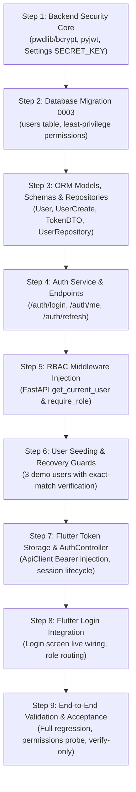

# PayShield — Phase 3 Implementation Plan

**Project:** PayShield — Educational Mobile Fraud Risk Monitoring System  
**Repository:** `D:\Code\PayShield`  
**Current Baseline Commit:** `4f4bbaa`  
**Branch:** `main`  
**Author:** Senior Software Architect & Technical Lead  
**Document Status:** PROPOSAL / PLANNING ONLY (No code modifications, migrations, or seed changes)  
**Date:** 2026-11-04  

---

## 1. Roadmap Gap Analysis & Objective

### 1.1 Documented Roadmap Discrepancy
An architectural review of `docs/PAYSHIELD_MASTER_DOCUMENTATION.md` reveals a divergence in how Phase 3 / Milestone 3 is defined across sections:

1. **Section 15 (Sequential Implementation Roadmap) & Section 21 (Final Definition of Done):**
   - **Milestone 3** is explicitly defined as:
     > **"Milestone 3 — Authentication and role authorization"**  
     > *Build:* User seed script, password hashing, login, token validation, `/auth/me`, role dependencies.  
     > *Learn:* Authentication vs authorization, JWT, password hashing, middleware/dependencies.  
     > *Acceptance:* Merchant, Analyst and Admin test accounts have correct access; unauthorized requests fail.
   - Section 21 ("Final definition of done") records the only two incomplete core system requirements:
     - `[ ] Login works for Merchant, Analyst and Admin demo accounts.`
     - `[ ] Backend validates authentication and role permissions.`
     *(All database schema, transaction ingestion, heuristic risk scoring, case resolution, and dashboard analytics are already marked complete `[x]` as of Milestone 2 Phase 2).*

2. **Section 20.1 (Milestones Status Table):**
   - Line 1208 records:
     > `| **Milestone 3** | Phase 3 | ML Model Training & Inference (Future scope) | Pending | - |`
   - In Section 15, Machine Learning was originally partitioned into **Milestone 5** (*ML dataset and model*) and **Milestone 6** (*Risk scoring integration*).

### 1.2 Proposed Resolution & Strategic Options

| Option | Phase 3 Target Scope | Technical Rationale & Trade-offs | Recommendation Status |
|:---|:---|:---|:---:|
| **Option 1 (Recommended)** | **Authentication, User Entity & Server-Side RBAC (Milestone 3)** | Enforces server-side security across all existing 9 live endpoints. Resolves the two open items in Section 21 Definition of Done. Complies with the mandatory rule: *"Hiding a Flutter button is not authorization. Authentication and authorization must be enforced on the backend."* | **PRIMARY ARCHITECTURAL RECOMMENDATION** |
| **Option 2** | **Machine Learning Training & Inference Engine (Milestones 5 & 6)** | Replaces or augments the deterministic `HEURISTIC_RULES_V1` engine with scikit-learn model inference. However, leaves the entire REST API unauthenticated and open to unauthorized queries/mutations. | Valid Alternative (Deferred security) |
| **Option 3** | **Two-Stage Phase 3: Phase 3A (Auth & RBAC) $\rightarrow$ Phase 3B (ML Inference)** | Formally unifies the roadmap: Phase 3A secures the system with users, credentials, and JWT RBAC; Phase 3B introduces the machine learning model training and inference pipeline within an authenticated boundary. | **COMPREHENSIVE MULTI-PHASE ROADMAP** |

*This implementation plan establishes the complete technical specification for **Option 1 (Phase 3A: Authentication & Role-Based Access Control)** as the immediate next phase, while detailing the interface contracts that enable seamless integration into **Phase 3B (ML Inference)**.*

---

## 2. Phase 3 Objective and Business Value

### 2.1 Objective
Transform PayShield from an open-access prototype into a secure, multi-role fraud monitoring console by implementing server-side user authentication, bcrypt password hashing, cryptographically signed JWT tokens, role-based access control (RBAC) middleware, and client session state synchronization in Flutter.

### 2.2 Business & Educational Value
- **Security Posture:** Replaces client-side UI simulation (`demoRoleProvider`) with cryptographically verified backend authorization.
- **Data Governance:** Links transactions, analyst cases, and audit logs to verified user identities rather than arbitrary string actor tokens.
- **Academic Defense / Viva Readiness:** Directly demonstrates standard OWASP API security patterns, cryptographic password hashing (Argon2id/bcrypt), stateless JWT claim validation, and clean separation between authentication (401 Unauthorized) and authorization (403 Forbidden).

---

## 3. Scope and Explicit Non-Goals

### 3.1 In Scope (Phase 3 Target)
1. **[Documented Requirement]** PostgreSQL `users` table schema with UUID primary keys, unique emails, hashed passwords, active flags, and role check constraints (`MERCHANT`, `ANALYST`, `ADMIN`).
2. **[Documented Requirement]** Safe Alembic migration (`0003_create_users_table`) with least-privilege PostgreSQL permissions granted to `payshield_app`.
3. **[Documented Requirement]** Cryptographic password hashing utility using modern secure algorithms (bcrypt / argon2).
4. **[Documented Requirement]** JWT token generation, signing (HS256 with server-side `SECRET_KEY`), validation, and expiration handling.
5. **[Documented Requirement]** Authentication REST endpoints: `POST /api/v1/auth/login`, `GET /api/v1/auth/me`, `POST /api/v1/auth/refresh`.
6. **[Documented Requirement]** FastAPI dependency injection guards (`get_current_user`, `require_role(role)`).
7. **[Documented Requirement]** Canonical demo user seeding for three standard accounts:
   - Merchant: `merchant@techpulse.bd`
   - Analyst: `analyst.shafiq@payshield.internal`
   - Admin: `admin.nayem@payshield.internal`
8. **[Documented Requirement]** Flutter authentication integration: Live login form connecting to `/auth/login`, token storage, and session injection into `ApiClient`.
9. **[Architectural Recommendation]** Protection of existing 9 endpoints behind appropriate role dependencies without breaking canonical seed verification or dashboard aggregates.

### 3.2 Explicit Non-Goals
1. **NO Real Payment Gateway Integration:** Strictly no integration with real bKash, Nagad, card schemes, or banking APIs.
2. **NO Production Identity Providers / OAuth2 / SSO:** No external social login, Google Auth, Auth0, or SAML. Self-contained educational JWT only.
3. **NO Public Self-Registration:** User creation remains administrative or demo-seeded; no open registration in production mode.
4. **NO SMS OTP / Email Verification:** No external telecom SMS or SMTP delivery; simulated MFA tokens only if requested in later phases.
5. **NO Production Fraud Model Claims:** Phase 3 does not claim production ML accuracy; ML model training belongs to Milestone 5/6 (Phase 3B).

---

## 4. Backend Architecture & Changes

### 4.1 New Backend Modules & Dependencies
Add to `backend/pyproject.toml`:
- `pwdlib[argon2]>=0.2.0` or `passlib[bcrypt]>=1.7.4` (for salted password hashing).
- `pyjwt>=2.9.0` (for RFC 7519 JWT signing and claim validation).

### 4.2 Module Structure Additions
```
backend/app/
├── core/
│   ├── security.py          # [NEW] Password hashing (bcrypt) & JWT encode/decode
│   └── dependencies.py      # [NEW] FastAPI auth & RBAC dependency injection
├── models/
│   └── user.py              # [NEW] SQLAlchemy ORM User entity
├── schemas/
│   └── auth.py              # [NEW] Pydantic DTOs for login, token, user profile
├── repositories/
│   └── user_repository.py   # [NEW] User database queries
├── services/
│   └── auth_service.py      # [NEW] Authentication business logic & credential validation
└── api/v1/
    └── auth.py              # [NEW] Router mounting /auth/login, /auth/me, /auth/refresh
```

### 4.3 Endpoint Security Retrofitting
Existing endpoints will be secured using FastAPI dependencies:
- `GET /health`, `GET /api/v1/health`, `GET /api/v1/readiness`: **Public** (Monitoring & probes).
- `POST /api/v1/auth/login`: **Public** (Credential submission).
- `GET /api/v1/auth/me`: **Authenticated** (Any active user).
- `GET /api/v1/dashboard/*`: **Authenticated** (Merchant: own metrics; Analyst/Admin: system-wide).
- `POST /api/v1/transactions`: **Role-Restricted** (`MERCHANT`, `ADMIN`).
- `GET /api/v1/transactions`: **Role-Scoped** (Merchant: filter `merchant_id`; Analyst/Admin: all).
- `GET /api/v1/cases`, `PATCH /api/v1/cases/*`: **Role-Restricted** (`ANALYST`, `ADMIN`).
- `PATCH /api/v1/transactions/{ref}/status`: **Role-Restricted** (`ANALYST`, `ADMIN`).

---

## 5. Database Schema & Migration Strategy

### 5.1 New Table: `users`
Defined in accordance with `docs/PAYSHIELD_MASTER_DOCUMENTATION.md` Section 8.1:

```sql
CREATE TABLE users (
    id UUID PRIMARY KEY DEFAULT gen_random_uuid(),
    email VARCHAR(255) NOT NULL,
    full_name VARCHAR(255) NOT NULL,
    password_hash VARCHAR(255) NOT NULL,
    role VARCHAR(20) NOT NULL,
    is_active BOOLEAN NOT NULL DEFAULT true,
    created_at TIMESTAMPTZ NOT NULL DEFAULT now(),
    updated_at TIMESTAMPTZ NOT NULL DEFAULT now(),
    CONSTRAINT uq_users_email UNIQUE (email),
    CONSTRAINT ck_users_role CHECK (role IN ('MERCHANT', 'ANALYST', 'ADMIN')),
    CONSTRAINT ck_users_email_non_empty CHECK (length(trim(email)) > 0)
);

CREATE INDEX ix_users_email ON users (email);
CREATE INDEX ix_users_role ON users (role);
```

### 5.2 Foreign Key Backfills & Relational Integrity
- **`merchants.owner_user_id`**: Add nullable UUID column referencing `users(id)` ON DELETE SET NULL.
- **`analyst_cases.assigned_analyst_id`**: Add nullable UUID column referencing `users(id)` ON DELETE SET NULL (preserves `assigned_analyst` string column for display compatibility).

### 5.3 PostgreSQL Permission Grants
In Alembic migration `0003_create_users_table.py`:
- `payshield_migrator`: Table owner, full DDL.
- `payshield_app`:
  - `GRANT SELECT, INSERT ON users TO payshield_app;`
  - Explicit column-level update on mutable fields:
    `GRANT UPDATE (password_hash, full_name, is_active, updated_at) ON users TO payshield_app;`
  - Table-level `DELETE`, `TRUNCATE`, and `UPDATE` on `id`, `email`, `role` denied.

### 5.4 Canonical Demo Users
Seed script extension (`backend/scripts/seed_demo_data.py`):
1. **Merchant User:**
   - Email: `merchant@techpulse.bd`
   - Name: `Demo Merchant Owner`
   - Role: `MERCHANT`
   - Password: `Password123!` (hashed via bcrypt)
2. **Analyst User:**
   - Email: `analyst.shafiq@payshield.internal`
   - Name: `Shafiqul Islam (Lead Analyst)`
   - Role: `ANALYST`
   - Password: `Password123!` (hashed via bcrypt)
3. **Admin User:**
   - Email: `admin.nayem@payshield.internal`
   - Name: `Nayem Ahmed (System Administrator)`
   - Role: `ADMIN`
   - Password: `Password123!` (hashed via bcrypt)

*Seed Recovery Guarantee:* Multi-entity seed boundary verification checks exact user counts and emails; matches are verified non-destructively.

---

## 6. Flutter Client Architecture & Changes

### 6.1 State Management & Architecture
```
mobile/lib/features/auth/
├── data/
│   ├── auth_repository.dart       # [NEW] Network calls to /auth/login and /auth/me
│   └── token_storage.dart         # [NEW] Secure persistence for JWT tokens
├── domain/
│   ├── auth_tokens.dart           # [NEW] Access & refresh token entity
│   └── user_session.dart          # [NEW] Authenticated user profile entity
└── presentation/
    ├── auth_controller.dart       # [NEW] Riverpod StateNotifier managing AuthState
    └── login_screen.dart          # [UPDATE] Wire form submission to auth_controller
```

### 6.2 Token Persistence & Interceptor
1. **`TokenStorage` Interface:**
   - In production/release: Uses `flutter_secure_storage` for Android Keystore encryption.
   - In desktop/test mode: In-memory fallback or encrypted preferences.
2. **`ApiClient` Authorization Header Injection:**
   ```dart
   // When user is authenticated, automatically append Bearer token
   if (token != null) {
     headers['Authorization'] = 'Bearer $token';
   }
   ```
3. **Graceful 401 Session Eviction:**
   - If backend returns HTTP 401, clear stored tokens and redirect via `go_router` to `/login`.

---

## 7. API Contracts

### 7.1 `POST /api/v1/auth/login`
- **Access:** Public
- **Request Body:**
```json
{
  "email": "analyst.shafiq@payshield.internal",
  "password": "Password123!"
}
```
- **Response (200 OK):**
```json
{
  "access_token": "eyJhbGciOiJIUzI1NiIsInR5cCI6IkpXVCJ9...",
  "token_type": "bearer",
  "expires_in": 3600,
  "user": {
    "id": "7a3b4c5d-6e7f-8091-a2b3-c4d5e6f7a8b9",
    "email": "analyst.shafiq@payshield.internal",
    "full_name": "Shafiqul Islam (Lead Analyst)",
    "role": "ANALYST"
  }
}
```
- **Error Response (401 Unauthorized):**
```json
{
  "detail": "Invalid credentials",
  "code": "INVALID_CREDENTIALS"
}
```

### 7.2 `GET /api/v1/auth/me`
- **Access:** Authenticated (Bearer Token)
- **Response (200 OK):**
```json
{
  "id": "7a3b4c5d-6e7f-8091-a2b3-c4d5e6f7a8b9",
  "email": "analyst.shafiq@payshield.internal",
  "full_name": "Shafiqul Islam (Lead Analyst)",
  "role": "ANALYST",
  "is_active": true,
  "created_at": "2026-11-04T05:22:15Z"
}
```

---

## 8. Security & Authorization Matrix

| Endpoint | Method | Public | MERCHANT | ANALYST | ADMIN | Unauthorized Code |
|:---|:---|:---:|:---:|:---:|:---:|:---:|
| `/health`, `/api/v1/readiness` | `GET` | Yes | Yes | Yes | Yes | N/A |
| `/api/v1/auth/login` | `POST` | Yes | Yes | Yes | Yes | N/A |
| `/api/v1/auth/me` | `GET` | No | Yes | Yes | Yes | `401 Unauthorized` |
| `/api/v1/transactions` (Ingest) | `POST` | No | Yes | No | Yes | `403 Forbidden` |
| `/api/v1/transactions` (List) | `GET` | No | Own Only | All | All | `403 Forbidden` |
| `/api/v1/transactions/{ref}` | `GET` | No | Own Only | All | All | `404 Not Found` (anti-enumeration) |
| `/api/v1/transactions/{ref}/status`| `PATCH`| No | No | Yes | Yes | `403 Forbidden` |
| `/api/v1/cases` (List/Inspect) | `GET` | No | No | Yes | Yes | `403 Forbidden` |
| `/api/v1/dashboard/summary` | `GET` | No | Own Stats| System | System | `401 Unauthorized` |

---

## 9. Testing Strategy

1. **Password Hashing & Token Unit Tests:**
   - Verify bcrypt salt generation, verification timing, and rejection of plain text.
   - Verify JWT expiration (`exp` claim), invalid signature rejection, and malformed token handling.
2. **RBAC Endpoint Integration Tests (`pytest`):**
   - Test 401 on unauthenticated calls to protected routes.
   - Test 403 on role mismatch (e.g., Merchant trying to patch analyst case).
   - Test successful authenticated flow across all 3 roles.
3. **Database Permission Tests:**
   - Verify `payshield_app` cannot `DROP TABLE users` or `DELETE FROM users`.
   - Verify `payshield_app` cannot modify `users.role` (column-level update restriction).
4. **Canonical Seed Preservation:**
   - Execute `seed_demo_data.py --verify-only` to guarantee the 175 canonical transactions and ৳ 482,500.00 volume remain 100% untouched.
5. **Flutter Auth Suite:**
   - Unit tests for `AuthController` state transitions (`unauthenticated` $\rightarrow$ `authenticating` $\rightarrow$ `authenticated`).
   - Mock network integration tests for token persistence and 401 refresh/eviction.

---

## 10. Migration and Rollback Strategy

1. **Forward Migration (`alembic upgrade head`):**
   - Generates `0003_create_users_table.py` using `payshield_migrator`.
   - Creates `users` table, unique index on email, and role CHECK constraint.
   - Grants least-privilege permissions to `payshield_app`.
2. **Rollback Strategy (`alembic downgrade -1`):**
   - Reverts permissions.
   - Drops `users` table cleanly.
   - Leaves Milestone 2 tables (`transactions`, `analyst_cases`, etc.) 100% operational.
3. **Zero Seed Disruption:**
   - The user seed step will be an isolated function within `seed_demo_data.py` with its own exact-match verification.

---

## 11. Acceptance Criteria

Phase 3 will be formally accepted when:
1. `alembic upgrade head` completes cleanly on `payshield_dev` and `payshield_test`.
2. Exactly 3 demo accounts (`merchant@techpulse.bd`, `analyst.shafiq@payshield.internal`, `admin.nayem@payshield.internal`) are verified via `--verify-only`.
3. `POST /api/v1/auth/login` returns valid signed JWT tokens.
4. Calling protected endpoints without a Bearer token returns `401 Unauthorized`.
5. Merchant accounts are strictly denied access to analyst queue (`403 Forbidden`).
6. Flutter mobile app logs in successfully, stores the token, and displays role-tailored dashboard data.
7. Canonical transaction dataset remains 100% intact (175 transactions, exact minor units).
8. All unit and integration test suites pass in CI/test runners.

---

## 12. Estimated Implementation Sequence



---

## 13. Summary Recommendation for Project Owner

> [!IMPORTANT]
> **Action Required from Project Owner:**
> 1. Approve **Option 1 (Authentication & RBAC)** as Phase 3 scope to secure existing endpoints and complete the Section 21 Definition of Done, **OR**
> 2. Direct the team to proceed with **Option 2 (Machine Learning Model Training & Serving)** if academic priorities require delivering the predictive fraud model before securing the API.
>
> Awaiting approval before modifying code, schemas, or dependencies.
